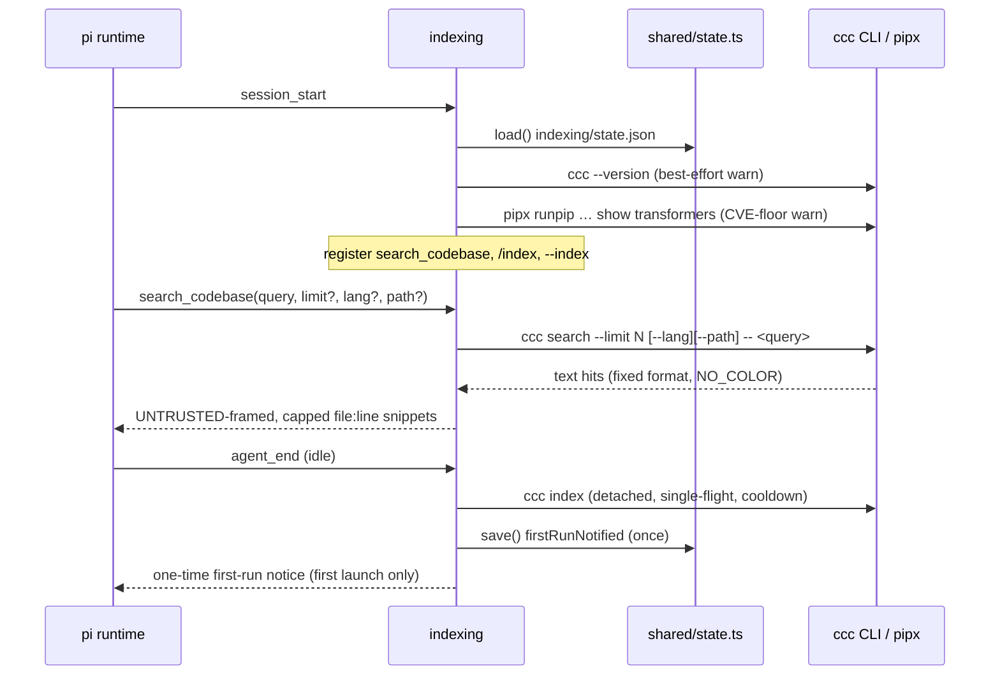
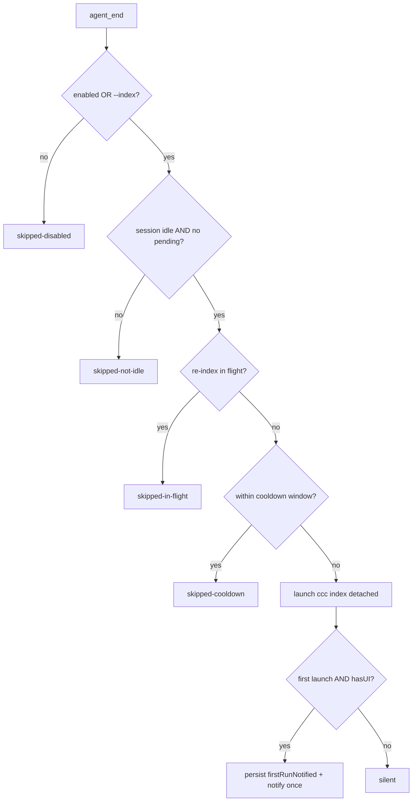
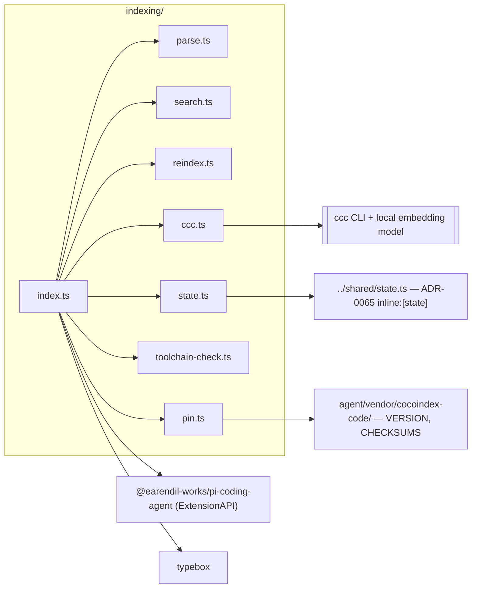

# indexing

Semantic codebase search for the Pi coding agent, backed by
[`cocoindex-code`](https://pypi.org/project/cocoindex-code/) (the `ccc` CLI).
Registers a `search_codebase` tool so the agent can locate relevant code/docs by
meaning — returning `file:line` snippets — instead of reading whole files, and
keeps the index fresh with an idle-gated background re-index. See
[ADR-0033](https://github.com/psmfd/pi-config/blob/main/adrs/0033-codebase-indexing.md).

## Install

```sh
pi install git:github.com/psmfd/pi-indexing
```

Try it first without installing: `pi -e git:github.com/psmfd/pi-indexing`.

## Why custom (not an adopted extension)

Phase 0 (#328) named two candidate extensions; both were rejected on inspection
(#336, ADR-0033):

- **`@pi-unipi/cocoindex`** targets a *different* engine (the `cocoindex`
  framework + LanceDB, not `ccc`/`cocoindex-code`), has no `agent_end` background
  re-index, and carries an unresolved LanceDB AGPL-contamination caveat.
- **`pi-cocoindex`** (elpapi42) uses the right engine and architecture but is
  stale (no activity since 2026-04-26) and built on the abandoned
  `@mariozechner/*` package namespace, incompatible with pi v0.79.0.

The **engine** (`cocoindex-code`, Apache-2.0, actively maintained) is healthy and
is the real value; this thin extension owns only the pi-side wiring, satisfying
every suite convention by design.

## What it does

- **`search_codebase` tool** — runs `ccc search` (CLI tool-call path) and returns
  ranked snippets. Always available (queries whatever index exists).
- **`agent_end` background re-index** — idle-gated, single-flight, cooldown-throttled
  `ccc index`. `ccc index` is incremental (a no-op when nothing changed).

## Controls

| Control | Effect |
| --- | --- |
| `/index status` | Show toggle state, pinned `ccc` version, and index stats. |
| `/index on` \| `/index off` | Enable/disable the `agent_end` background re-index (persisted). |
| `/index build` | Kick off a `ccc index` now (background). |
| `--index` | Enable the background re-index for this session only. |
| `SKIP_INDEXING=1` | Stand the extension down (yields a project-shipped `search_codebase`). |
| `CCC_BIN_PATH` | Absolute path to the `ccc` binary (else `$PIPX_BIN_DIR/ccc`, else `~/.local/bin/ccc`). |

The search tool is **always** registered; `enabled` governs only the background
re-index, which is **ON by default** (`enabled: true`). The first time it actually
runs — it reads the whole codebase — a one-time notice explains it and points at
`/index off`; disable it with `/index off` (persisted) or `SKIP_INDEXING=1`. If
`search_codebase` reports that the project is not indexed, prefer the built-in
`/index build` path from pi; on a brand-new host, run `ccc init` once if `/index
build` reports that first-time ccc setup is still missing, then run `/index build`
again.

## Setup (external toolchain)

The engine is installed out-of-band (it is not part of `setup.sh`'s fetch flow):

```bash
pipx install --python python3.13 'cocoindex-code[full]'   # Python >= 3.11 required
ccc init      # creates .cocoindex_code/ (already gitignored); confirms local embeddings
ccc index     # first build downloads the embedding model (~90 MB, one-time)
```

The `[full]` extra runs embeddings **locally** (`Snowflake/snowflake-arctic-embed-xs`),
so no cloud key is needed. The pinned engine version and the embedding-model
revision + weights SHA-256 are recorded in [`pin.ts`](pin.ts) and mirrored under
[`agent/vendor/cocoindex-code/`](https://github.com/psmfd/pi-config/blob/main/agent/vendor/cocoindex-code/).

## Security posture (ADR-0033)

- **No MCP.** `cocoindex-code` ships an MCP server (`ccc mcp`, and the
  `cocoindex-code` entry point). `assertCliInvocation` fails closed on either —
  the extension can only ever launch the `ccc` CLI search/index/status path. Per
  [`agent/rules/no-mcp-servers.md`](https://github.com/psmfd/pi-config/blob/main/agent/rules/no-mcp-servers.md).
- **Untrusted output.** Search hits are indexed *repository content* and may
  carry injection strings. Results enter context as tool output (activity-stream
  visible, not system role), framed with an explicit untrusted-content header and
  hard-capped per-result and per-call.
- **Path/arg containment.** A `--path` glob is rejected if absolute, containing
  `..`, or beginning with `-`; `--lang` is rejected if it begins with `-`; and all
  query words are emitted after a `--` end-of-options sentinel — so no filter or
  query token can be reparsed as a `ccc` flag to escape the project root.
- **Secret-stripped subprocess env.** `ccc` (and the pipx probe) inherit an
  allowlisted env, never the agent session's secrets (`ANTHROPIC_API_KEY`,
  `GITHUB_TOKEN`, cloud creds).
- **Pinned model + CVE floor.** The embedding model is pinned by HF revision +
  weights SHA-256 (trust-on-first-use mitigation); the `transformers >= 5.3.0`
  floor (CVE-2026-4372) is **enforced at runtime** — `session_start` warns once if
  the ccc venv's transformers is below it. Telemetry is disabled
  (`COCOINDEX_DISABLE_USAGE_TRACKING=1`). See [`pin.ts`](pin.ts) for which pins are
  runtime-checked vs validator-checked.

## Coexistence

Uses **`agent_end`** + `session_start` + a `search_codebase` tool + an `/index`
command. No `before_agent_start` (auto-router), `context` (context-manager), or
`session_before_compact` (compaction-optimizer) — no hook collisions. pi requires
globally-unique tool names; `SKIP_INDEXING=1` stands down for a project that
ships its own `search_codebase`.

## Refusal policy (per-rule)

The `search_codebase` tool refuses before any subprocess spawn; every rule below
is a **hard refusal** (the tool call returns `isError` and no `ccc` is launched).

| Rule | Mode |
|---|---|
| Empty / whitespace-only `query` | Hard refusal |
| `--path` filter beginning with `-` (arg-injection) | Hard refusal |
| `--path` filter absolute or drive-rooted | Hard refusal |
| `--path` filter containing a `..` segment (traversal) | Hard refusal |
| `--lang` filter beginning with `-` (arg-injection) | Hard refusal |
| `ccc` spawn error (ENOENT / not installed) | Hard refusal (surfaced with install hint) |
| `ccc` output classified `error` / `not-initialized` | Hard refusal (surfaced with remediation) |
| Non-`ccc` binary or `ccc mcp` subcommand (`assertCliInvocation`) | Hard refusal (no-MCP, fail-closed) |

The background re-index is not a tool call and has no refusals — it is gated (see
the decision flow below), not refused.

## Diagrams

### Communication flow — events, tool, and subprocess



### Decision flow — the background re-index gate ladder



`/index build` bypasses the enabled / idle / cooldown gates (the user asked) but
still respects the single-flight lock, so it cannot race a background re-index
into two concurrent `ccc index` writers.

### Dependency flow — imports and pinned surfaces



## Files

| File | Role |
| --- | --- |
| `index.ts` | Factory: tool + `/index` command + `--index` flag + `agent_end` re-index + `session_start` version/CVE-floor checks. |
| `ccc.ts` | `ccc` subprocess boundary: binary resolution, no-MCP guard, secret-stripped env, runner + launcher + `transformers` probe. |
| `parse.ts` | Parse + classify `ccc search` output (pure). |
| `search.ts` | Query construction, `--path`/`--lang` validation, untrusted result framing (pure). |
| `reindex.ts` | Idle-gated, single-flight, cooldown-throttled background re-index. |
| `state.ts` | Persisted toggle + output caps (`shared/state.ts`). |
| `toolchain-check.ts` | Pure evaluation of the `transformers` CVE floor against a probe result. |
| `pin.ts` | Pinned `ccc` version + embedding-model revision/SHA + transformers floor. |
| `types.ts` | Structural types + injectable process boundaries. |

## Tests

`scripts/test-indexing.sh` (also run by `validate.sh`) — **61 tests across 7
files**. No installed `ccc` is required: the pure modules import pi/typebox only as
types, and the `index.ts` wiring test redirects state to a temp HOME and exercises
the pre-spawn refusal paths (it does import `index.ts`, so the runner hydrates
extension-deps for `typebox`, ADR-0021).

| Suite | Tests | Covers |
| --- | --- | --- |
| `search.test.ts` | 13 | limit clamping, `--path`/`--lang` validation, untrusted framing + caps |
| `parse.test.ts` | 12 | block parsing (incl. embedded-header hardening), output classification |
| `ccc.test.ts` | 10 | binary resolution, no-MCP guard, version parse, secret-stripping `childEnv` |
| `reindex.test.ts` | 8 | gate ladder, single-flight, cooldown, lock reset on failure |
| `toolchain-check.test.ts` | 7 | `transformers` version parse/compare, fail-open CVE-floor eval |
| `index.test.ts` | 6 | tool/command/flag registration, refusal paths, first-run once-gate |
| `state.test.ts` | 5 | default + cap repair + fail-safe coercion |
